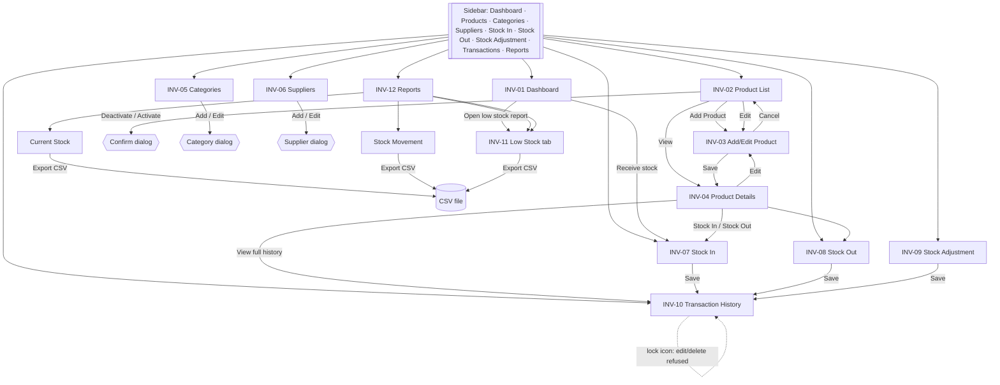

# 2. Screen Navigation Flow

## Route map
| Screen ID | Screen | Route |
| --- | --- | --- |
| INV-01 | Dashboard | `/` |
| INV-02 | Product List | `/products` |
| INV-03 | Add / Edit Product | `/products/new`, `/products/:id/edit` |
| INV-04 | Product Details | `/products/:id` |
| INV-05 | Category Management (dialog for add/edit) | `/categories` |
| INV-06 | Supplier Management (dialog for add/edit) | `/suppliers` |
| INV-07 | Stock In | `/stock-in` (optional `?product=<id>`) |
| INV-08 | Stock Out | `/stock-out` (optional `?product=<id>`) |
| INV-09 | Stock Adjustment | `/stock-adjustment` (optional `?product=<id>`) |
| INV-10 | Transaction History | `/transactions` (optional `?product=<id>`) |
| INV-11 | Low Stock Report | `/reports?tab=low-stock` (also `/reports/low-stock`) |
| INV-12 | Inventory Reports | `/reports` (`?tab=stock \| movement \| low-stock`) |
| — | Not found | any other path |

Related screens are combined as the specification allows: add/edit category and supplier use dialogs; the three reports use tabs.

## Flow diagram

(Stock In/Out/Adjustment stay on the form after saving and show a confirmation; the arrows to *Transactions* show where the new record can be viewed.)

## Unknown or invalid addresses
* `/products/<unknown id>` and `/products/<unknown id>/edit` → "Product not found" message with a link back (AC-22).
* Any other unknown path → "Page not found" message with a link to the Dashboard.
* Stored data missing/corrupt → Recovery screen instead of the app (FR-015).
